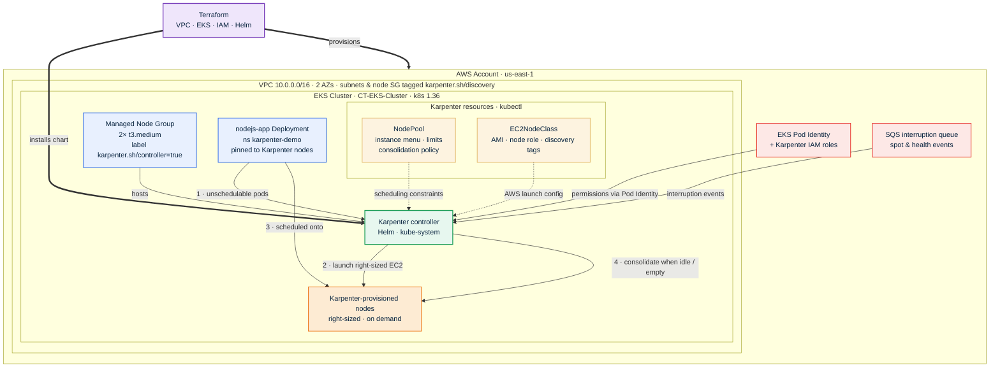

# Scaling an EKS Cluster with Karpenter

When a Kubernetes cluster runs out of room, something has to add nodes. For years that job belonged to the Cluster Autoscaler, which scales fixed-size node groups up and down. [Karpenter](https://karpenter.sh/) takes a different approach: it looks at the pods that can't be scheduled, works out the cheapest mix of instances that would fit them, and launches those instances directly. No pre-defined node groups to size, no guessing which instance type to standardise on.

In this post we build an EKS cluster with Terraform, install Karpenter, and prove the scaling works by pushing a real Node.js app up and down. Every snippet comes straight from the repo linked at the end.

## What we are building

The stack splits cleanly into two layers:

1. **Terraform** stands up the VPC, the EKS control plane, a small managed node group to host system pods and the Karpenter controller, and all the IAM / SQS plumbing Karpenter needs.
2. **Kubernetes manifests** tell Karpenter *how* to provision nodes (the `NodePool` and `EC2NodeClass`) and give it something to react to (a scalable demo Deployment).



The key idea: the Karpenter controller itself runs on the stable managed node group (pinned with a `nodeSelector`), while the workloads it scales land on nodes it creates. That separation keeps the controller from ever evicting itself.

## Part 1: The Terraform layer

### Tagging resources for discovery

Karpenter finds the subnets and security group to use by looking for a tag, `karpenter.sh/discovery`, whose value is the cluster name. We set that tag on the private subnets in the VPC module and on the node security group in the EKS module.

```hcl
# VPC module — private subnets
private_subnet_tags = {
  "kubernetes.io/role/internal-elb"           = "1"
  "kubernetes.io/cluster/${var.cluster_name}" = "shared"
  # Lets Karpenter auto-discover these subnets for the nodes it launches
  "karpenter.sh/discovery" = var.cluster_name
}
```

```hcl
# EKS module
# Tag the node security group so Karpenter can auto-discover it.
# Only one security group in the account should carry this tag.
node_security_group_tags = {
  "karpenter.sh/discovery" = var.cluster_name
}
```

### A home for the controller

The EKS managed node group stays small (two `t3.medium` on-demand nodes). It exists to run system add-ons and the Karpenter controller. The label pins the controller here:

```hcl
eks_managed_node_groups = {
  EKS_Node_Group = {
    min_size     = 1
    max_size     = 3
    desired_size = 2

    instance_types = ["t3.medium"]
    capacity_type  = "ON_DEMAND"
    ami_type       = "AL2023_x86_64_STANDARD"

    # The Karpenter controller is pinned to this managed node group so it
    # never schedules onto nodes that Karpenter itself provisions.
    labels = {
      "karpenter.sh/controller" = "true"
    }
  }
}
```

The cluster also enables the `eks-pod-identity-agent` add-on, which Karpenter uses to assume its IAM role without any OIDC/IRSA wiring.

### The Karpenter sub-module

The `terraform-aws-modules/eks/aws` module ships a Karpenter sub-module that creates everything the controller needs: a controller IAM role with an EKS Pod Identity association, a node IAM role plus instance profile, an EKS access entry for the launched nodes, and an SQS queue (wired to EventBridge) for spot-interruption and instance-health events.

```hcl
module "karpenter" {
  source  = "terraform-aws-modules/eks/aws//modules/karpenter"
  version = "~> 21.0"

  cluster_name = module.eks.cluster_name

  # The node IAM role name must match the `role` set in the EC2NodeClass manifest.
  node_iam_role_use_name_prefix = false
  node_iam_role_name            = var.cluster_name

  # Use EKS Pod Identity (requires the eks-pod-identity-agent addon)
  create_pod_identity_association = true

  node_iam_role_additional_policies = {
    AmazonSSMManagedInstanceCore = "arn:aws:iam::aws:policy/AmazonSSMManagedInstanceCore"
  }
}
```

### Installing the controller with Helm

Finally we install the Karpenter chart from the public ECR registry and point it at the cluster and the interruption queue. The `nodeSelector` keeps it on the managed node group.

```hcl
resource "helm_release" "karpenter" {
  name       = "karpenter"
  namespace  = var.karpenter_namespace # kube-system
  repository = "oci://public.ecr.aws/karpenter"
  chart      = "karpenter"
  version    = var.karpenter_chart_version # 1.6.0
  wait       = false

  values = [
    yamlencode({
      nodeSelector = { "karpenter.sh/controller" = "true" }
      dnsPolicy    = "Default"
      settings = {
        clusterName       = module.eks.cluster_name
        clusterEndpoint   = module.eks.cluster_endpoint
        interruptionQueue = module.karpenter.queue_name
        enableZonalShift  = true
      }
      webhook = { enabled = false }
    })
  ]

  depends_on = [module.eks, module.karpenter, null_resource.update_kubeconfig]
}
```

## Part 2: Using Karpenter from YAML

Terraform installs the controller, but it does nothing until you tell it what kind of nodes to create and under what rules. That is the job of two custom resources that live in `k8s-manifests/karpenter/`.

### EC2NodeClass — the AWS "how"

The `EC2NodeClass` is the AWS-specific half: which AMI, which IAM role, which subnets and security groups. The discovery tags and the `role` name must match what Terraform created (both default to the cluster name, `CT-EKS-Cluster`).

```yaml
apiVersion: karpenter.k8s.aws/v1
kind: EC2NodeClass
metadata:
  name: default
spec:
  amiSelectorTerms:
    - alias: al2023@latest           # match the managed node group AMI family
  role: CT-EKS-Cluster               # = module.karpenter node IAM role
  subnetSelectorTerms:
    - tags:
        karpenter.sh/discovery: CT-EKS-Cluster
  securityGroupSelectorTerms:
    - tags:
        karpenter.sh/discovery: CT-EKS-Cluster
  tags:
    karpenter.sh/discovery: CT-EKS-Cluster
```

### NodePool — the Kubernetes "what" and "when"

The `NodePool` is the scheduling half. It constrains which instance types Karpenter may pick, caps total capacity, and sets a disruption policy so idle or underused nodes are consolidated away.

```yaml
apiVersion: karpenter.sh/v1
kind: NodePool
metadata:
  name: default
spec:
  template:
    spec:
      nodeClassRef:
        group: karpenter.k8s.aws
        kind: EC2NodeClass
        name: default
      requirements:
        - key: "karpenter.k8s.aws/instance-category"
          operator: In
          values: ["c", "m", "r"]
        - key: "karpenter.k8s.aws/instance-cpu"
          operator: In
          values: ["4", "8", "16", "32"]
        - key: "karpenter.k8s.aws/instance-hypervisor"
          operator: In
          values: ["nitro"]
        - key: "karpenter.k8s.aws/instance-generation"
          operator: Gt
          values: ["2"]
        - key: "kubernetes.io/arch"
          operator: In
          values: ["amd64"]
        - key: "karpenter.sh/capacity-type"
          operator: In
          values: ["on-demand"]
  limits:
    cpu: 1000
  disruption:
    consolidationPolicy: WhenEmptyOrUnderutilized
    consolidateAfter: 30s
```

A few things worth calling out:

- **`requirements`** are a menu, not a fixed choice. Karpenter is free to pick any `c`, `m`, or `r` instance with 4–32 vCPUs as long as it is Nitro-based and newer than generation 2. Widening this menu gives the scheduler more room to find cheap, well-fitting capacity.
- **`limits`** is the safety ceiling. Karpenter will never provision more than 1000 vCPUs worth of nodes from this pool.
- **`disruption`** is what makes the cluster shrink. `WhenEmptyOrUnderutilized` lets Karpenter remove or replace nodes once their pods could pack onto fewer instances, `consolidateAfter: 30s` sets how long it waits before acting.

### A workload that drives scaling

Nodes only appear when pods can't be scheduled. The demo Deployment makes that happen on purpose: each replica requests real CPU and memory, and node affinity forces every replica onto a Karpenter node (`karpenter.sh/nodepool` only exists on nodes Karpenter made). So the moment you scale the Deployment, Karpenter has unschedulable pods to answer.

```yaml
apiVersion: apps/v1
kind: Deployment
metadata:
  name: nodejs-app
  namespace: karpenter-demo
spec:
  replicas: 5
  selector:
    matchLabels:
      app.kubernetes.io/name: nodejs-app
  template:
    metadata:
      labels:
        app.kubernetes.io/name: nodejs-app
    spec:
      affinity:
        nodeAffinity:
          requiredDuringSchedulingIgnoredDuringExecution:
            nodeSelectorTerms:
              - matchExpressions:
                  - key: karpenter.sh/nodepool   # only Karpenter nodes qualify
                    operator: Exists
      topologySpreadConstraints:
        - maxSkew: 1
          topologyKey: kubernetes.io/hostname    # spread pods across nodes
          whenUnsatisfiable: ScheduleAnyway
          labelSelector:
            matchLabels:
              app.kubernetes.io/name: nodejs-app
      terminationGracePeriodSeconds: 0
      containers:
        - name: nodejs-app
          image: public.ecr.aws/n4o6g6h8/simple-nodejs-app-1:latest
          ports:
            - containerPort: 8080
          resources:
            requests:
              cpu: 500m
              memory: 256Mi
            limits:
              cpu: "1"
              memory: 512Mi
```

The `topologySpreadConstraints` block pushes replicas onto different hosts, so a scale-up needs more than one node and the autoscaling is easy to see.

## Implementation steps

**1. Provision the infrastructure.**

```bash
cd infrastructure
terraform init
terraform plan
terraform apply
```

This creates the VPC, cluster, managed node group, Karpenter IAM roles and SQS queue, and installs the controller. The `null_resource.update_kubeconfig` step updates your kubeconfig automatically.

**2. Confirm the controller is running.**

```bash
kubectl get pods -n kube-system -l app.kubernetes.io/name=karpenter

NAME                         READY   STATUS    RESTARTS   AGE
karpenter-5cdc6cdd7c-bsb7h   1/1     Running   0          29m
karpenter-5cdc6cdd7c-hn55w   1/1     Running   0          29m
```

**3. Register the NodePool and EC2NodeClass.**

```bash
kubectl apply -f k8s-manifests/karpenter/default-nodepool.yaml
```

**4. Deploy the demo app and watch nodes appear.**

```bash
kubectl apply -f k8s-manifests/karpenter/nodejs-app-scale.yaml

# In separate terminals:
kubectl logs -f -n kube-system -l app.kubernetes.io/name=karpenter
kubectl get nodes -l karpenter.sh/registered=true -w
kubectl get pods -n karpenter-demo -o wide -w

$ kubectl get nodes -l karpenter.sh/registered=true
NAME                          STATUS   ROLES    AGE    VERSION
ip-10-0-20-105.ec2.internal   Ready    <none>   5m9s   v1.36.5-eks-577a51e

$ kubectl get pods -n karpenter-demo -o wide
NAME                          READY   STATUS    RESTARTS   AGE    IP            NODE                          NOMINATED NODE   READINESS GATES
nodejs-app-76fb46d8cd-2r86j   1/1     Running   0          5m7s   10.0.20.219   ip-10-0-20-105.ec2.internal   <none>           <none>
nodejs-app-76fb46d8cd-68lxb   1/1     Running   0          5m7s   10.0.20.242   ip-10-0-20-105.ec2.internal   <none>           <none>
nodejs-app-76fb46d8cd-7s5w2   1/1     Running   0          5m7s   10.0.20.241   ip-10-0-20-105.ec2.internal   <none>           <none>
nodejs-app-76fb46d8cd-fq692   1/1     Running   0          5m7s   10.0.20.25    ip-10-0-20-105.ec2.internal   <none>           <none>
nodejs-app-76fb46d8cd-t8mlq   1/1     Running   0          5m7s   10.0.20.48    ip-10-0-20-105.ec2.internal   <none>           <none>
```

**5. Scale up, then down.**

```bash
# Force more pending pods -> Karpenter adds nodes
kubectl -n karpenter-demo scale deployment nodejs-app --replicas 15


$ kubectl get nodes -l karpenter.sh/registered=true
NAME                          STATUS   ROLES    AGE    VERSION
ip-10-0-10-132.ec2.internal   Ready    <none>   21s    v1.36.5-eks-577a51e
ip-10-0-10-17.ec2.internal    Ready    <none>   21s    v1.36.5-eks-577a51e
ip-10-0-10-201.ec2.internal   Ready    <none>   21s    v1.36.5-eks-577a51e
ip-10-0-10-226.ec2.internal   Ready    <none>   21s    v1.36.5-eks-577a51e
ip-10-0-10-227.ec2.internal   Ready    <none>   20s    v1.36.5-eks-577a51e
ip-10-0-10-230.ec2.internal   Ready    <none>   20s    v1.36.5-eks-577a51e
ip-10-0-10-232.ec2.internal   Ready    <none>   20s    v1.36.5-eks-577a51e
ip-10-0-10-32.ec2.internal    Ready    <none>   21s    v1.36.5-eks-577a51e
ip-10-0-20-105.ec2.internal   Ready    <none>   7m1s   v1.36.5-eks-577a51e

$ kubectl get pods -n karpenter-demo -o wide
NAME                          READY   STATUS    RESTARTS   AGE     IP            NODE                          NOMINATED NODE   READINESS GATES
nodejs-app-76fb46d8cd-2r86j   1/1     Running   0          7m52s   10.0.20.219   ip-10-0-20-105.ec2.internal   <none>           <none>nodejs-app-76fb46d8cd-68lxb   1/1     Running   0          7m52s   10.0.20.242   ip-10-0-20-105.ec2.internal   <none>           <none>nodejs-app-76fb46d8cd-7s5w2   1/1     Running   0          7m52s   10.0.20.241   ip-10-0-20-105.ec2.internal   <none>           <none>nodejs-app-76fb46d8cd-fq692   1/1     Running   0          7m52s   10.0.20.25    ip-10-0-20-105.ec2.internal   <none>           <none>nodejs-app-76fb46d8cd-kk5d9   1/1     Running   0          72s     10.0.10.114   ip-10-0-10-17.ec2.internal    <none>           <none>nodejs-app-76fb46d8cd-lb52g   1/1     Running   0          72s     10.0.10.100   ip-10-0-10-32.ec2.internal    <none>           <none>nodejs-app-76fb46d8cd-nxfjc   1/1     Running   0          72s     10.0.20.72    ip-10-0-20-105.ec2.internal   <none>           <none>nodejs-app-76fb46d8cd-pb4fp   1/1     Running   0          72s     10.0.10.184   ip-10-0-10-32.ec2.internal    <none>           <none>nodejs-app-76fb46d8cd-pr6v5   1/1     Running   0          72s     10.0.10.194   ip-10-0-10-17.ec2.internal    <none>           <none>nodejs-app-76fb46d8cd-rclv5   1/1     Running   0          72s     10.0.10.56    ip-10-0-10-32.ec2.internal    <none>           <none>nodejs-app-76fb46d8cd-rg7q4   1/1     Running   0          72s     10.0.10.177   ip-10-0-10-32.ec2.internal    <none>           <none>nodejs-app-76fb46d8cd-rlq5d   1/1     Running   0          72s     10.0.20.123   ip-10-0-20-105.ec2.internal   <none>           <none>nodejs-app-76fb46d8cd-snfwx   1/1     Running   0          72s     10.0.10.89    ip-10-0-10-17.ec2.internal    <none>           <none>nodejs-app-76fb46d8cd-t8mlq   1/1     Running   0          7m52s   10.0.20.48    ip-10-0-20-105.ec2.internal   <none>           <none>nodejs-app-76fb46d8cd-zl9tj   1/1     Running   0          72s     10.0.10.117   ip-10-0-10-17.ec2.internal    <none>           <none>

# Remove the demand -> Karpenter consolidates and terminates empty nodes
kubectl -n karpenter-demo scale deployment nodejs-app --replicas 0

$  kubectl get pods -n karpenter-demo -o wide
No resources found in karpenter-demo namespace.

$ kubectl get nodes -l karpenter.sh/registered=true
No resources found
```

Within a minute or two of the scale-up you should see new `Node` objects join; after the scale-down, `consolidationPolicy: WhenEmptyOrUnderutilized` tears them back out. That full round trip is the whole point of Karpenter: capacity that tracks demand instead of a fixed, hand-tuned node group.

## Cleanup

Delete the Kubernetes workloads first so Karpenter removes the nodes it created, then destroy the Terraform stack. Removing the pods before `terraform destroy` avoids orphaned EC2 instances that Terraform does not track.

```bash
# 1. Remove the demo workload and let Karpenter drain its nodes
kubectl delete -f k8s-manifests/karpenter/nodejs-app-scale.yaml
kubectl delete -f k8s-manifests/karpenter/default-nodepool.yaml

# 2. Confirm no Karpenter-provisioned nodes remain
kubectl get nodes -l karpenter.sh/registered=true

# 3. Tear down the infrastructure
cd infrastructure
terraform destroy
```

## Conclusion

Karpenter changes cluster autoscaling from "resize these node groups" to "give me what my pods need." With a single `NodePool` and `EC2NodeClass` you describe a range of acceptable instances and a consolidation policy, and the controller handles the rest: picking instance types, launching nodes when pods pend, and reclaiming them when demand drops. The Terraform module does the heavy lifting on IAM, Pod Identity, and interruption handling, so the day-to-day interface is just two YAML files and `kubectl scale`.

From here you can extend the setup with spot capacity (add `"spot"` to `karpenter.sh/capacity-type`), multiple NodePools with weights for different workloads, or taints that reserve Karpenter nodes for specific teams.

## References

- Project repository: [github.com/chinmayto/terraform-aws-eks-karpenter](https://github.com/chinmayto/terraform-aws-eks-karpenter)
- [Karpenter documentation](https://karpenter.sh/docs/)
- [Karpenter NodePools](https://karpenter.sh/docs/concepts/nodepools/) and [NodeClasses](https://karpenter.sh/docs/concepts/nodeclasses/)
- [Karpenter disruption & consolidation](https://karpenter.sh/docs/concepts/disruption/)
- [terraform-aws-modules/eks — Karpenter sub-module](https://github.com/terraform-aws-modules/terraform-aws-eks/tree/master/modules/karpenter)
